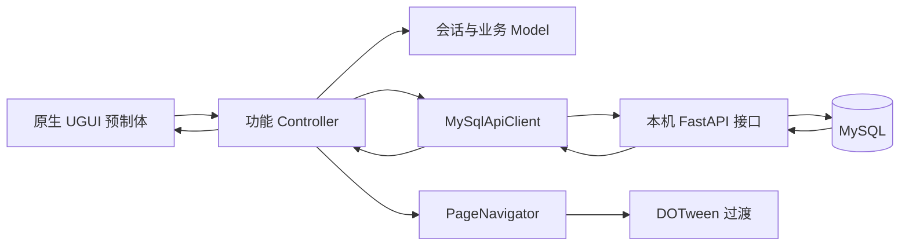
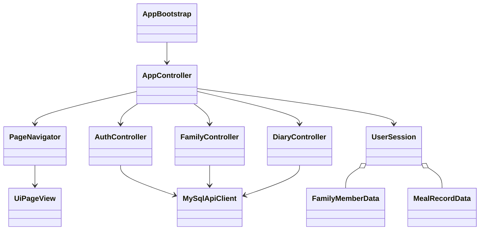
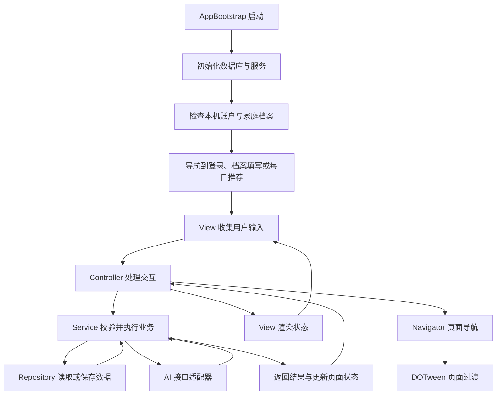
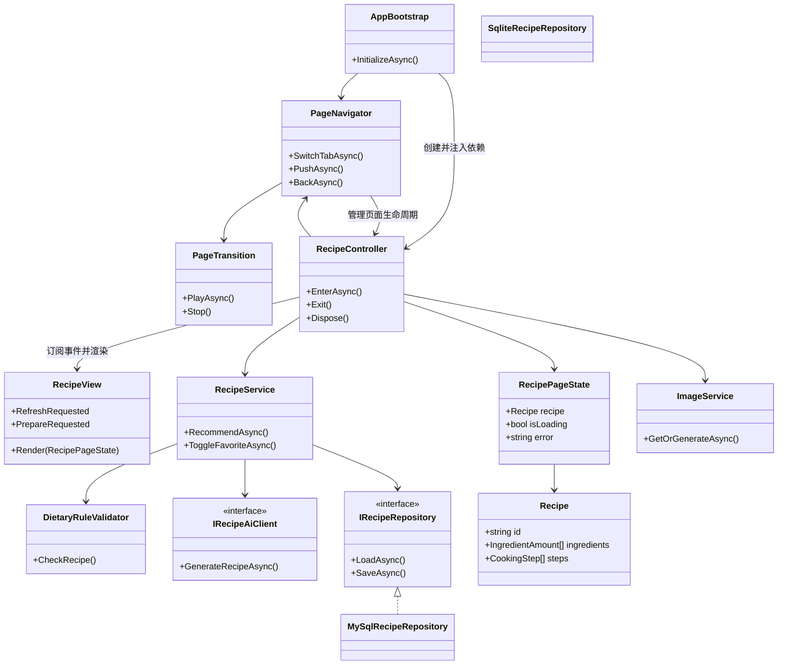

# 家膳智选架构草案

状态：第一阶段已落地 UI、注册登录、家庭档案、手动饮食记录及 MySQL；AI 模块保留后续设计。下面先说明实际代码，再保留完整扩展方案。

## 当前实现

页面过渡统一由 `PageNavigator` 控制，时长 0.35 秒，全部采用 OutCubic。进入子页时，子页从右侧滑入、父页左移屏宽的 25%、父页黑色遮罩从 0 增至 25%；返回执行反向位移与遮罩变化。同级主导航不播放动画。首次档案填写步骤直接切换，登录成功及首次档案完成页退出时向下滑出。页面自身透明度始终为 1。

当前返回栈保留隐藏的父视图，因此普通返回能保留输入与滚动位置；保存后返回列表会重建列表以刷新数据。主导航切换、登录完成及退出账户时清理旧返回栈。后续若引入持续相机/语音或页面独立请求，需要额外实现进入与离开回调，在隐藏时停止相应订阅。

当前使用轻量 MVC。`UiPageView` 保存视图组件引用；`AuthController`、`FamilyController`、`DiaryController` 处理各自业务；`UserSession`、`FamilyMemberData`、`MealRecordData` 保存数据。`AppController` 负责事件路由与公共弹窗，`AppBootstrap` 组装依赖。





数据库采用已确认的 MySQL，开发时运行于当前 Windows 电脑。Unity 通过本机 HTTP 接口访问；SQL 与数据库凭据保留在 `Server`，客户端不直接携带 MySQL 密码。移动端后续需要局域网或部署服务器，不能把本机 MySQL 当成手机内嵌数据库。

当前没有引入尚无复用需求的 Service/Repository 接口。后续 AI 推荐、份量规则、营养计算复杂起来后，再按下文拆分；避免为每个简单类提前增加空层。界面中未接入的功能显示空状态，不生成演示业务数据。

## 总体选择

采用按功能组织的 MVC，辅以业务 Service 和 Repository。View 是绑定 Inspector 的 MonoBehaviour，Controller 是普通 C# 类，Model 是普通数据对象与状态。AppBootstrap 在启动时手动创建并注入依赖，不引入额外 DI 框架。

View 只负责显示、输入与事件。Controller 负责页面交互、请求生命周期与导航。Service 负责跨页面可复用的业务规则。Repository 封装持久化。网络与数据库实现放在 Infrastructure，页面不直接使用它们。

## 流程图



## 代表性类图

此图展开推荐模块，其他模块遵循相同边界，不代表所有页面共用一个 Controller。



## 功能划分

| 模块 | Controller | 核心业务与数据 |
| --- | --- | --- |
| 本机账户 | AuthController | AuthService、Account |
| 家庭档案 | FamilyController | FamilyService、FamilyMember、DietaryProfile |
| 菜谱推荐与详情 | RecommendationController、RecipeDetailController | RecipeService、Recipe、IngredientAmount、CookingStep |
| 拍照选菜 | ShoppingController | ShoppingService、ProduceInspectionResult |
| 备菜与烹饪 | PreparationController、CookingController | CookingService、CookingSession、TimerState |
| 语音助手 | VoiceController | VoiceService、VoiceSession |
| 饮食记录 | DiaryController | DiaryService、MealRecord、NutritionAmount |

类图的 RecipeController 是推荐类控制器的示意名称。落地时采用表中的具体命名，避免新增一个职责重复的通用控制器。

收藏和屏蔽属于菜谱模块，不另建庞大系统。家庭档案首次填写与后续编辑复用 FamilyService。餐次摄入属于个人记录，不把整道家庭菜谱直接作为个人食用量。

## 导航与生命周期

采用一个主要 UI 场景，页面为 Prefab。底部导航管理主页面切换，详情与编辑页使用返回栈，确认框使用弹窗层。页面注册表先显式注册，不采用反射扫描。

页面进入时订阅事件并创建请求取消源，退出时解绑事件、取消页面请求并停止所属动画。隐藏也算退出，不能仅依赖对象销毁。快速切页时串行处理过渡，避免多次点击形成叠加页面。

语音会话、烹饪计时由 Service 管理，可以跨页面继续；页面关闭只停止显示订阅。退出烹饪会话时再停止语音和会话计时。倒计时根据结束时刻计算，回前台时重新校准，不把 DOTween 动画时间作为计时依据。

## 数据边界

- 领域数据：家庭成员、菜谱、食材用量、烹饪步骤、饮食记录。
- 页面状态：加载状态、错误提示、当前选择，只供显示，不直接存数据库。
- API DTO：大模型返回 JSON，先解析校验，再转领域数据，不直接绑定到 UI。
- 持久化：确定使用 MySQL，不引入其他数据库。当前通过电脑本机接口访问，后续手机运行需要明确服务地址和局域网连接。SQL 封装于服务端，页面不直接执行 SQL。
- 静态配置：少量选项与提示模板使用 ScriptableObject/JSON，营养数据必须附来源、单位及版本。
- 图片文件存磁盘缓存，数据库只记索引和文件路径。家庭档案、记录与收藏依旧本地保存。

过敏食材校验先采用确定的词典和规则，不把大模型返回当成安全保证。无法识别的复合配料提示用户核对。

## AI 调用

推荐先返回菜谱文字，再独立加载封面。图片结果以菜谱 ID 和生成参数关联，避免快速换菜后旧图片覆盖新内容。成功结果可缓存，不因返回页面重复生图。

文本生成、图像理解、生图、语音使用分开的能力接口，避免一个巨大的 AIManager。接口按能力建立，不为每个普通类都创建接口。正式分发时用轻量代理保护模型密钥，业务数据仍以本地为主。

UniTask 统一处理可取消请求、加载和过渡。错误在适配层转换成可识别错误类型，Controller 决定重试或显示提示。取消属于正常退出，不显示网络失败。测试优先覆盖禁忌筛选、份量计算、记录汇总、旧请求覆盖和数据库升级。

## 插件选择

| 工具 | 第一阶段决定 | 用途 |
| --- | --- | --- |
| DOTween | 已导入本地 1.3.030 包 | 当前由 PageNavigator 播放页面动画，复杂时再独立 PageTransition |
| UniTask | 已嵌入 2.5.10 并锁定版本 | 网络请求、图片加载、页面过渡与取消 |
| Luban | 暂不导入 | 日后静态食材、营养与规则表规模扩大时再评估 |
| SaveData_Json | 暂不直接整包导入 | 包含 LitJson，先评估封装与现有 Newtonsoft.Json 的重复依赖 |
| SaveData_PlayerPrefs | 仅考虑设置类数据 | 不作为家庭档案和饮食记录数据库 |
| Singleton、AB_Manager、LuaManager、XLua | 暂不导入 | 当前无需全局单例体系、热更新或资源热更 |

Luban 用于编辑期静态配置生成，不能替代运行时数据库，也不用于保存 AI 每次生成的菜谱。

## 后续目录规划（按需演进）

```text
Assets/JiaShan/
  App/                 # 启动与依赖组装
  Core/UI/             # 导航、基础页面、过渡与公共控件
  Features/
    Auth/
    Family/
    Recipes/
    Shopping/
    Cooking/
    Voice/
    Diary/
  Infrastructure/
    AI/                # 提供商 DTO 与能力接口实现
    Persistence/       # 数据库连接、Repository 实现、迁移
    Device/            # 相机、麦克风等平台能力
  Configs/
  Prefabs/UI/
  Art/
  Tests/
```

每个 Feature 内按需要建立 Models、Views、Controllers、Services，不创建空层级。第三方插件放独立目录，项目封装放项目目录。

## 维护约束

不在 View 中请求 AI、写 SQL、计算营养或查找其他页面。Controller 不膨胀为业务规则集合。AppBootstrap 是依赖组装点，不是所有页面可以任意查找服务的全局容器。不默认引入全局事件总线、通用泛型仓库、自动反射绑定或大量 Manager 单例。

先实现启动、导航和家庭档案，再打通推荐文字、详情、备菜、烹饪、记录；最后加入生图、选菜识别与语音。第一阶段 AI 不接入，显示空状态；所有保存的家庭资料与饮食记录都来自用户真实录入。

参考：UniTask https://github.com/Cysharp/UniTask ；DOTween https://dotween.demigiant.com/documentation.php ；Luban https://www.datable.cn/docs/intro 。插件本地文件位于 D:/Unity/__Tools。
